# 📷 ESP32-CAM Object Detection System

> *Вбудована система розпізнавання об'єктів на базі мікроконтролера ESP32-CAM з використанням Edge Impulse та сповіщеннями через Telegram.*

---

## 👤 Автор

- **ПІБ**: Волинець Юрій Вікторович
- **Група**: ФЕС–41с
- **Керівник**: Вельгош Сергій Романович, доцент
- **Дата виконання**: 01.06.2026

---

## 📌 Загальна інформація

- **Тип проєкту**: Вбудована система (Embedded System) + IoT
- **Мова програмування**: C++ (Arduino/PlatformIO)
- **Платформа**: ESP32-CAM (AI Thinker) з камерою OV3660
- **ML платформа**: Edge Impulse (FOMO, MobileNetV2 0.35, int8)
- **Бібліотеки**: Edge Impulse SDK, WiFiClientSecure, esp_camera, img_converters

### Апаратна частина

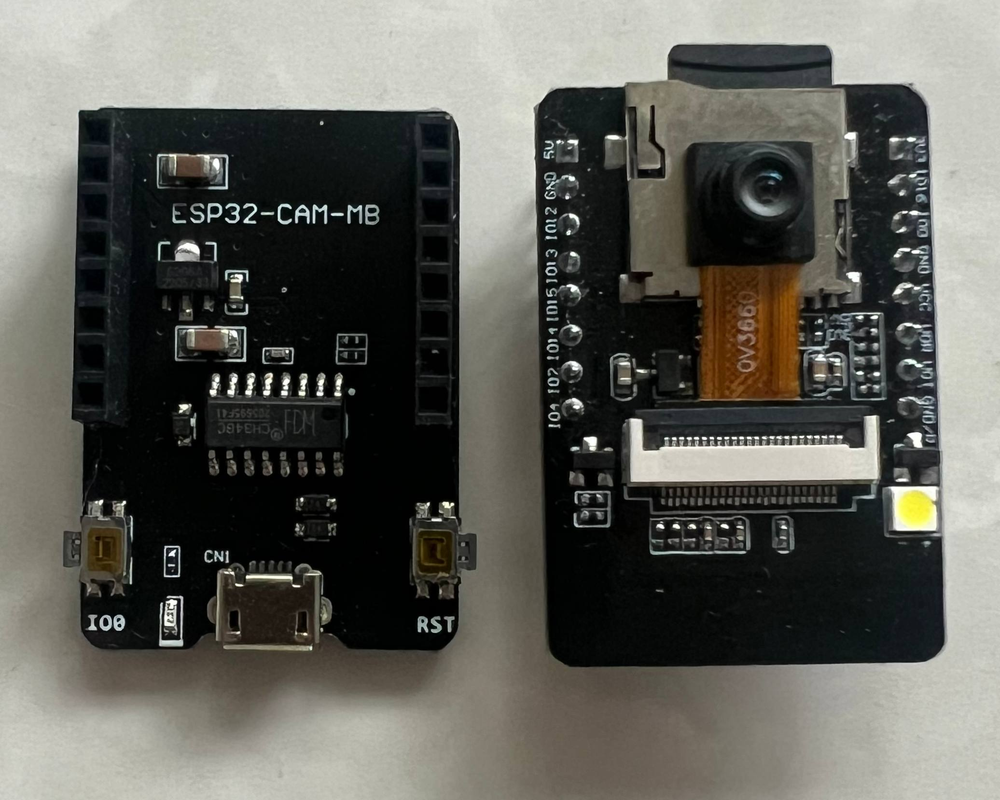
*Модуль ESP32-CAM-MB (ліворуч — плата розширення з CH340C, праворуч — ESP32-CAM з камерою OV3660)*

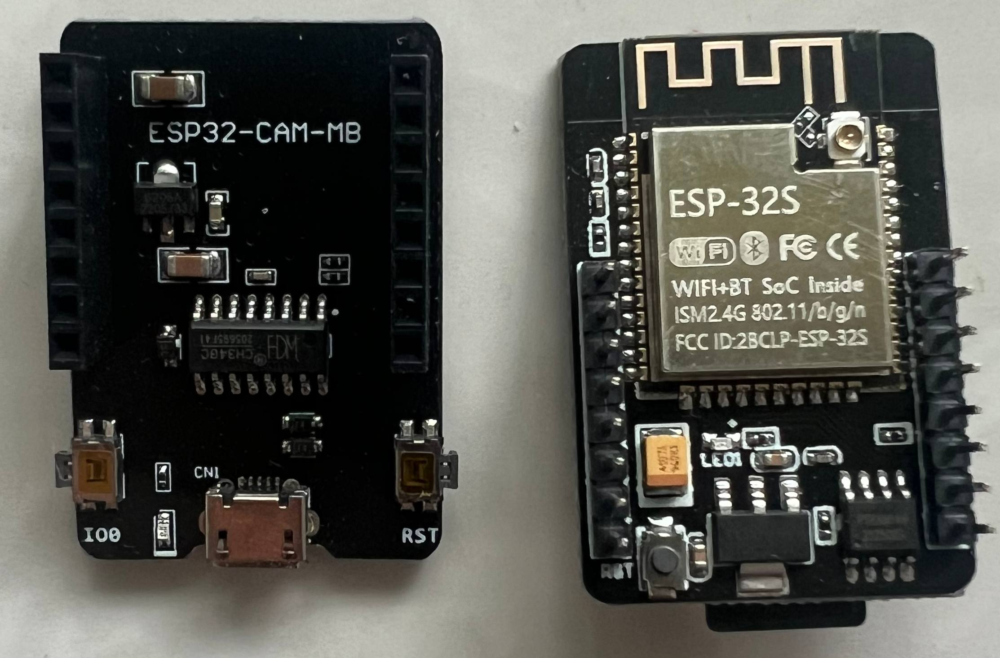
*Зворотній бік: плата розширення ESP32-CAM-MB та мікроконтролер ESP-32S (WiFi+BT SoC)*

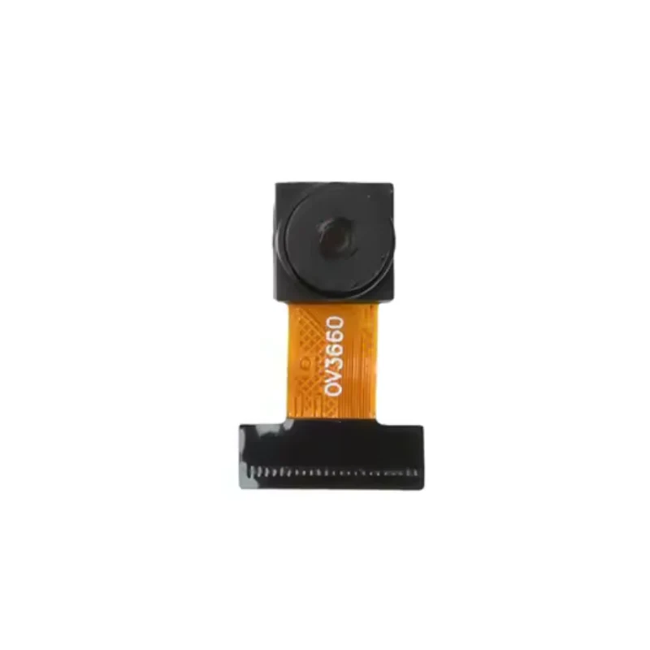
*Камера OV3660 з гнучким шлейфом DVP*

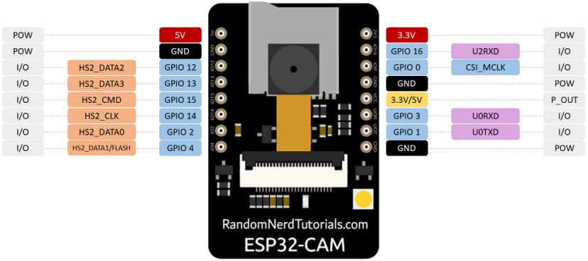
*Схема виводів ESP32-CAM*

---

## ⚙️ Технічні характеристики

| Параметр | Значення |
|----------|----------|
| Мікроконтролер | ESP32-S, 240 МГц, 520 КБ SRAM + 4 МБ PSRAM |
| Камера | OV3660, до 3 МП |
| Модель | FOMO + MobileNetV2 alpha 0.35 |
| Розмір моделі | 52 КБ (int8) |
| Час інференсу | 180–220 мс |
| Вхід моделі | 160×160 px, RGB |
| Поріг впевненості | 70% |
| Підтвердження | 3 кадри поспіль |
| Точність (Precision) | 93.6% |
| Повнота (Recall) | 88.0% |
| F1-score | 0.907 |

---

## 🧠 Опис функціоналу та архітектури

- 🎯 Виявлення людини в кадрі в режимі реального часу (4–5 кадрів/с)
- 🔍 Триступенева фільтрація хибних спрацювань (поріг впевненості, розмір bbox, тимчасове підтвердження)
- 📸 Автоматичне фотографування у VGA якості (640×480) при виявленні
- 📲 Надсилання фотосповіщень через Telegram Bot API
- 🔄 Cooldown механізм для запобігання спаму сповіщень (30 секунд)
- 📊 Моніторинг системи через Serial Monitor


## 🧱 Опис основних файлів

| Файл / Директорія | Призначення |
|-------------------|-------------|
| `src/main.cpp` | Основний код системи |
| `lib/D_inferencing/` | Edge Impulse SDK з квантизованою моделлю |
| `lib/D_inferencing/src/model-parameters/model_metadata.h` | Параметри моделі FOMO |
| `platformio.ini` | Конфігурація проекту PlatformIO |

---

## ▶️ Як запустити проєкт "з нуля"

### 1. Встановлення інструментів

- [VS Code](https://code.visualstudio.com/)
- Розширення [PlatformIO IDE](https://platformio.org/install/ide?install=vscode)
- Python 3.x (встановлюється разом з PlatformIO)

### 2. Клонування репозиторію

```bash
git clone https://github.com/your-user/esp32-cam-detection.git
cd esp32-cam-detection
```

### 3. Підключення Edge Impulse SDK

1. Зайдіть на [studio.edgeimpulse.com](https://studio.edgeimpulse.com)
2. Відкрийте свій проект → **Deployment** → **Arduino library**
3. Завантажте та розпакуйте у папку `lib/D_inferencing/`

**Збір датасету:**

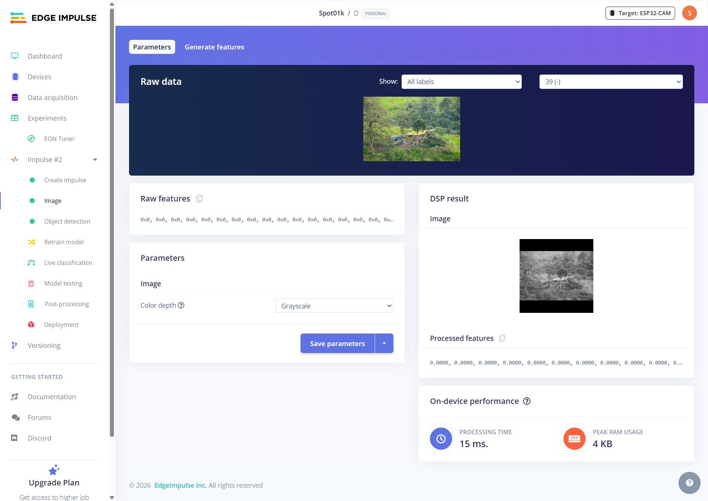
*Data Acquisition*

**Конфігурація імпульсу:**

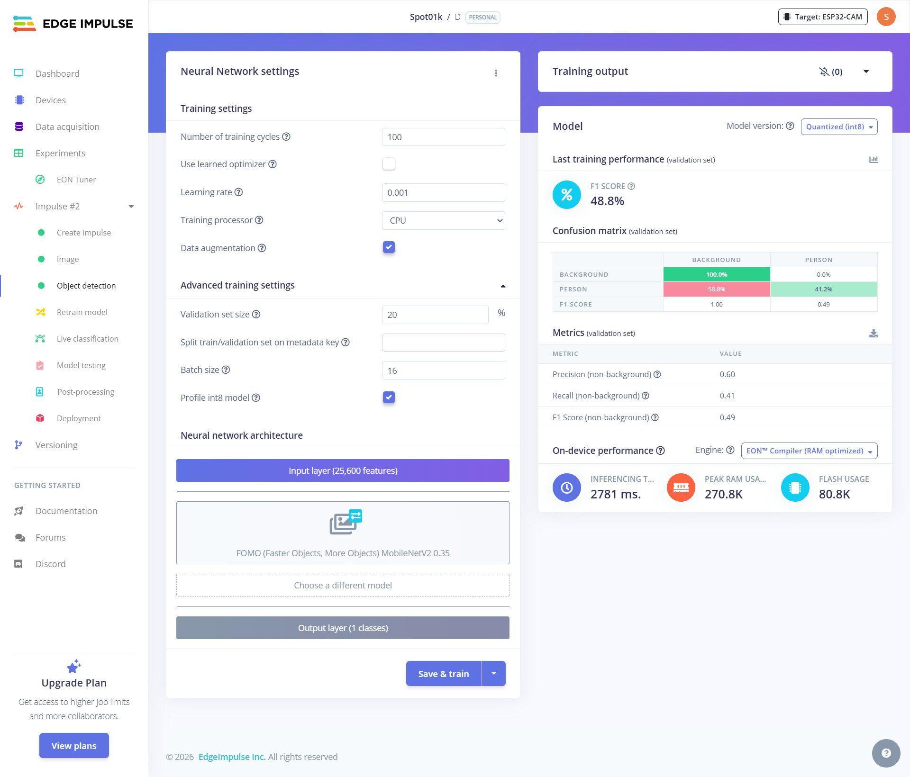
*Impulse #2: Image data 160×160, блок обробки Image, блок навчання Object Detection (FOMO)*

**Налаштування блоку обробки:**

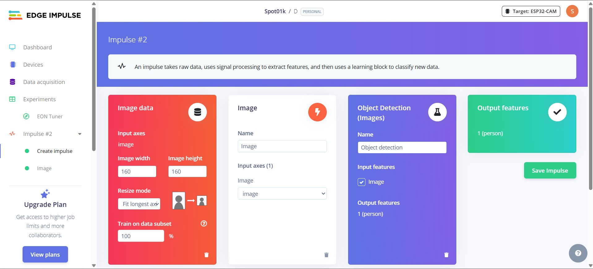
*Image processing block: Grayscale, Processing time 15ms, Peak RAM 4KB*

**Навчання моделі:**

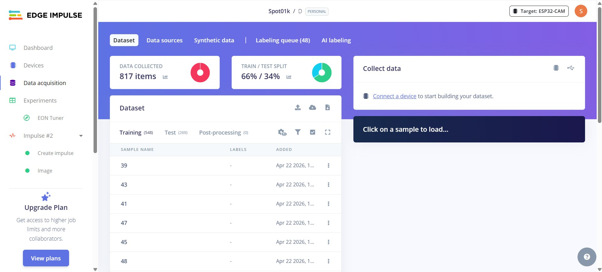
*Object Detection: FOMO MobileNetV2 0.35, 100 епох, Batch 16, LR 0.001, int8 квантизація*

### 4. Налаштування конфігурації

Відкрийте `src/main.cpp` та змініть наступні параметри:

```cpp
#define WIFI_SSID       "Ваш_WiFi"
#define WIFI_PASSWORD   "Ваш_пароль"
#define BOT_TOKEN       "токен_від_BotFather"
#define CHAT_ID         "ваш_chat_id"
```

**Як отримати BOT_TOKEN:**
1. Напишіть [@BotFather](https://t.me/BotFather) у Telegram
2. Команда `/newbot` → введіть назву → отримайте токен

**Як отримати CHAT_ID:**
1. Напишіть боту будь-яке повідомлення
2. Перейдіть: `https://api.telegram.org/bot{TOKEN}/getUpdates`
3. Знайдіть поле `"id"` у секції `"chat"`

### 5. Підключення ESP32-CAM-MB

```
ESP32-CAM-MB → комп'ютер через micro-USB кабель
```

> ⚠️ Використовуйте зовнішній блок живлення або USB-хаб з активним живленням (мінімум 500 мА).

### 6. Прошивка

```bash
pio run --target upload --environment esp32cam
```

### 7. Моніторинг

```bash
pio device monitor --port COM7 --baud 115200
```

---

## 🔧 Конфігурація `platformio.ini`

```ini
[env:esp32cam]
platform = espressif32
board = esp32cam
framework = arduino

monitor_speed = 115200
monitor_filters = default, esp32_exception_decoder

upload_speed = 921600

board_build.partitions = huge_app.csv

build_flags =
    -DCORE_DEBUG_LEVEL=0
    -O2
    -Wno-deprecated-declarations
    -Wno-cpp
```

---

## 📋 Налаштовувані параметри

```cpp
#define CONFIDENCE_THR   0.70   // Поріг впевненості (0.0 – 1.0)
#define ALERT_COOLDOWN   30000  // Затримка між сповіщеннями (мс)
#define CONFIRM_FRAMES   3      // Кількість кадрів для підтвердження
#define MIN_BOX_SIZE     20     // Мінімальний розмір bbox (пікселів)
#define STABILITY_FRAMES 2      // Кадрів без виявлення для скидання лічильника
```

---

## 🖱️ Інструкція для користувача

1. **Підключіть** ESP32-CAM-MB до живлення через micro-USB
2. **Дочекайтесь** підключення до Wi-Fi (10–20 секунд)
3. **Отримайте** повідомлення у Telegram про активацію
4. **Спрямуйте** камеру на зону спостереження
5. **Отримуйте** фотосповіщення при виявленні людини автоматично

---

## 📷 Приклади / скриншоти

### Serial Monitor

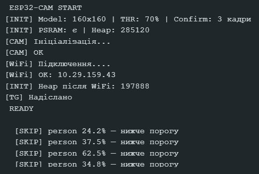
*Запуск системи: ініціалізація камери, підключення WiFi, готовність до роботи*

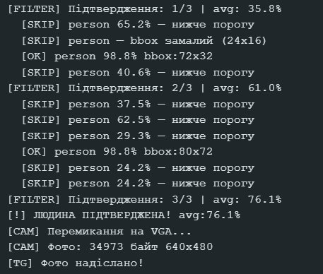
*Процес виявлення: FILTER підтвердження 1/3 → 2/3 → 3/3, ЛЮДИНА ПІДТВЕРДЖЕНА avg:76.1%, надсилання фото VGA 640×480*

### Telegram сповіщення

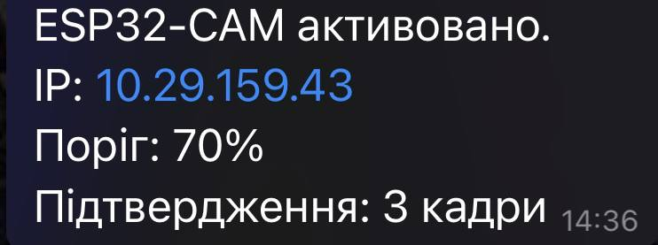
*Повідомлення про активацію системи: IP адреса, поріг 70%, підтвердження 3 кадри*

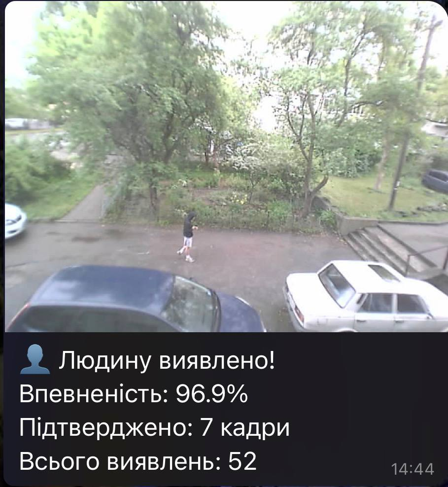
*Фотосповіщення: людина виявлена з впевненістю 96.9%, підтверджено на 7 кадрах, всього виявлень: 52*

---

## 🧪 Проблеми і рішення

| Проблема | Рішення |
|----------|---------|
| Помилка камери `0x105 (ESP_ERR_NOT_FOUND)` | Перевірити шлейф камери, змінити `PWDN_GPIO_NUM` на `32` |
| Нічого не виводиться в Serial Monitor | Натиснути кнопку RST на платі після відкриття монітора |
| WiFi не підключається | Перевірити SSID/пароль, ESP32 підтримує лише 2.4 ГГц |
| `FRAMESIZE_160X160` not declared | Використовувати `FRAMESIZE_96X96` + масштабування nearest-neighbor |
| Багато хибних спрацювань | Підвищити `CONFIDENCE_THR` до 0.80, збільшити `CONFIRM_FRAMES` до 5 |
| Telegram фото не надсилається | Перевірити BOT_TOKEN та CHAT_ID, забезпечити струм ≥ 500 мА |
| Система зависає після кількох годин | Перевірити витоки пам'яті, heap повинен залишатись стабільним |
| Помилка при прошивці | Переконатись що IO0 не з'єднаний з GND (лише під час прошивки) |

---

## 📁 Структура проєкту

```
esp32-cam-detection/
├── platformio.ini
├── README.md
├── src/
│   └── main.cpp
├── lib/
│   └── D_inferencing/
│       ├── D_inferencing.h
│       ├── src/
│       │   ├── model-parameters/
│       │   │   └── model_metadata.h
│       │   └── edge-impulse-sdk/
│       └── tflite-model/
│           └── tflite_learn_6.h
└── screenshots/
    ├── photo_1_esp32cam_mb.jpg
    ├── photo_2_esp32s.jpg
    ├── photo_3_tg_activation.jpg
    ├── photo_4_tg_detection.jpg
    ├── 1_training.png
    ├── 2_processing.png
    ├── 3_dataset.png
    ├── 4_impulse.png
    ├── 5_fomo.jpg
    ├── 6_mobilenetv2.png
    ├── 7_pinout.webp
    ├── 10_ov3660.webp
    ├── 11_serial_start.png
    └── 12_serial_detection.png
```

---

## 🧾 Використані джерела / література

- [Espressif ESP32 Technical Reference Manual](https://docs.espressif.com/projects/esp-idf/en/latest/esp32/)
- [Edge Impulse Documentation — FOMO](https://docs.edgeimpulse.com/docs/edge-impulse-studio/learning-blocks/object-detection/fomo-object-detection-for-constrained-devices)
- [Telegram Bot API Documentation](https://core.telegram.org/bots/api)
- [PlatformIO ESP32 Platform](https://docs.platformio.org/en/latest/platforms/espressif32.html)
- Warden P., Situnayake D. *TinyML: Machine Learning with TensorFlow Lite on Arduino and Ultra-Low-Power Microcontrollers*. O'Reilly Media, 2020.
- Sandler M. et al. *MobileNetV2: Inverted Residuals and Linear Bottlenecks*. CVPR 2018.
